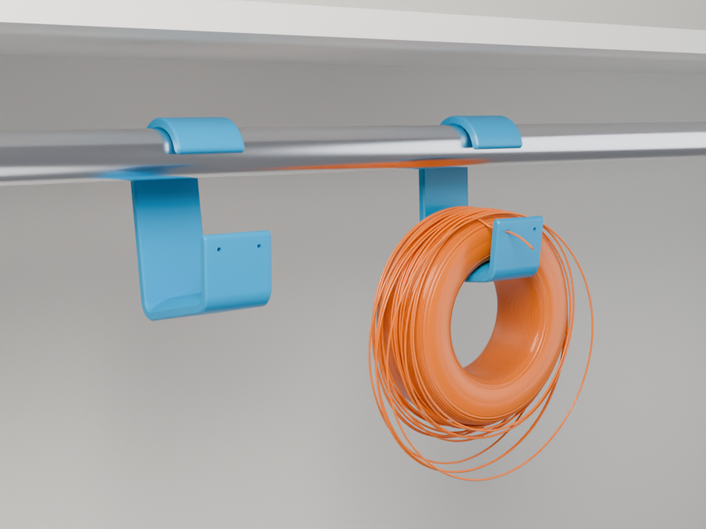
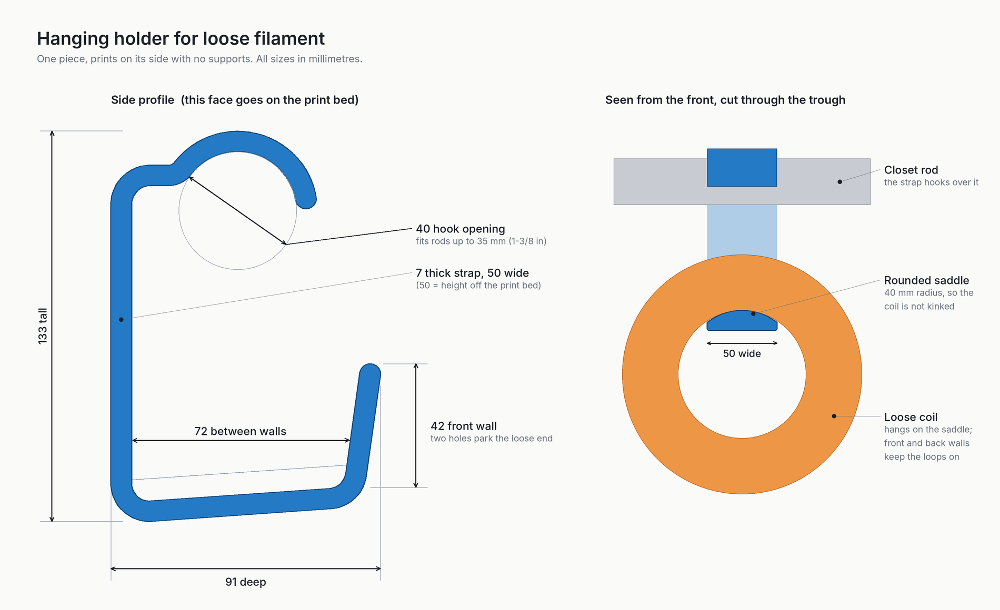

# Hanging holder for loose filament

A one-piece, 3D-printable hanger for a coil of filament that is no longer on a
spool. The top hooks over a closet rod; the bottom is a trough with a rounded
saddle that the coil drapes over, the way a garden hose sits on a hose hanger.





## Files

| File | What it is |
|---|---|
| `filament_hanger.stl` | The part, already lying in its print orientation |
| `filament_hanger.py` | The script that generates the STL; every size is a parameter |
| `preview.png`, `dimensions.png` | Render and dimension sheet |

## What it fits

- **Rod:** up to 35 mm (1-3/8 in) across. It needs about 25 mm (1 in) of free
  space above the rod to hook on.
- **Coil:** inside diameter of roughly 65 mm or more, up to a full 1 kg coil
  (windings stacked up to 50 mm deep, 72 mm between the walls).

## Printing

- Print it as exported: lying on its side, 92 x 133 mm on the bed, 50 mm tall.
- No supports. The only overhangs are the 45-degree chamfer, the saddle (36
  degrees at its steepest) and two 2.8 mm holes.
- 0.2 mm layers, 3-4 walls, 15-20 % infill. PLA is fine; use PETG if the closet
  gets hot.
- The solid volume is 123 cm3, so expect roughly 80 g of filament at those
  settings. That is an estimate from the volume; the model has not been sliced.

## Using it

1. Hook it over the rod, open side toward you.
2. Lift the top of the coil over the front wall and let it settle on the saddle.
3. Poke the loose end of the filament through one of the two holes in the front
   wall so the coil cannot unwind.

The hook is open enough to lift the holder off the rod with the coil still on
it. A couple of twist ties around the coil keep a very loose one tidier.

## Changing the size

```
pip install numpy shapely mapbox-earcut manifold3d
python3 filament_hanger.py --rod-d 32          # a thinner rod
python3 filament_hanger.py --channel 85        # a wider coil
python3 filament_hanger.py --help              # every parameter
```
