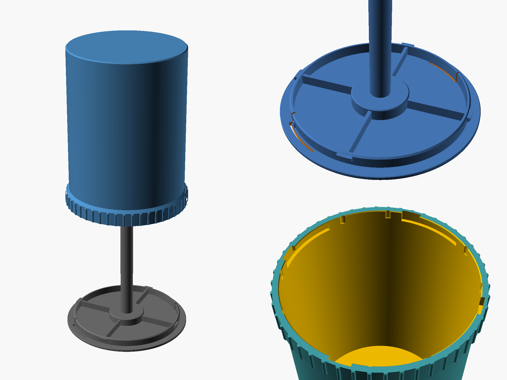

# DVD spindle holder with twist-lock cap

A "cake box" style holder for bare 120 mm discs (DVD, CD, Blu-ray), 7 in (177.8 mm) tall with the cap locked on. Two prints, no supports.



## Files

| File | What it is |
| --- | --- |
| `base.stl` | Base with spindle, flange down on the bed |
| `cap.stl` | Cap, already flipped so its top is on the bed |
| `dvd_holder.scad` | Parametric OpenSCAD source |

## Size

- Overall: 177.8 mm tall, 138.4 mm across the base.
- Capacity: about 130 discs (158 mm of stack height).
- Printer needs a 140 x 140 mm bed and 176 mm of Z height.

## Using it

1. Lower the cap and turn it until it drops over the four lugs.
2. Twist clockwise about 30 degrees until it clicks.
3. Twist anticlockwise past the click and lift to open.

The cap can be lifted by itself once locked; the lugs carry the weight of a full stack.

## Print settings

- 0.4 mm nozzle, 0.2 mm layers, no supports, no brim needed.
- Base: 3 or 4 walls, 15 to 20 % infill. Slow down for the top of the spindle if it wobbles.
- Cap: 3 walls. The 1.2 mm wall is all perimeters.
- PETG is the better choice for the two flex arms in the base. PLA works.
- Roughly 150 g for the cap and 60 to 70 g for the base.

## Tuning

Open `dvd_holder.scad` and change the values at the top, then re-export:

```
openscad -D 'part="base"' -o base.stl dvd_holder.scad
openscad -D 'part="cap"'  -o cap.stl  dvd_holder.scad
```

- Cap too tight or too loose on the base: `clear` (default 0.3).
- Click too stiff or too soft: `bump_bite` (default 0.5). Set `detent = false` to drop the click and rely on the twist alone.
- Lighter cap: `cap_wall` (0.8 gives two perimeters).
- Different height: `total_h`.

The fit, the lock and the overhangs were checked on the model geometry. It has not been test-printed.
